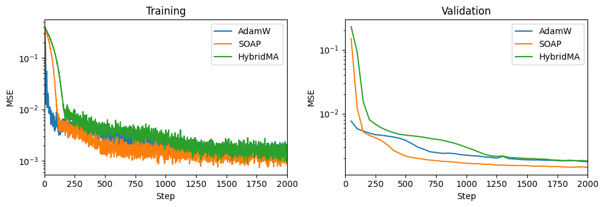
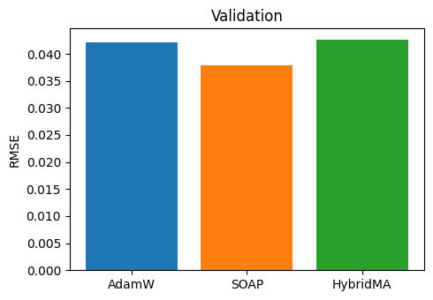

Comparing optimizers
====================

This tutorial compares the optimizers of ``shaggy``, **SOAP** and **HybridMA** (Muon for the weight matrices, AdamW for the rest), against the usual **AdamW**, on a small regression task: predicting the oxygen profile of an ocean column from its temperature profile.

.. code-block:: python

    import matplotlib.pyplot as plt
    import torch
    import torch.nn as nn

    from IPython.display import clear_output

    from shaggy.loss import loss_reconstruction
    from shaggy.optimizers import SOAP, HybridMA, safe_gradient_step

Configuration
-------------

All the parameters that influence the tutorial are grouped in the dictionaries below.

.. code-block:: python

    config = {
        "data": {
            "x": "data/x-dummy.pt",
            "mask": "data/m-dummy.pt",
            "n_val": 2_000,
            "seed": 0,
        },
        "model": {
            "hid_features": 128,
            "hid_layers": 2,
        },
        "train": {
            "lr": {"AdamW": 1e-3, "SOAP": 1e-3, "HybridMA": 1e-3},
            "weight_decay": 0.01,
            "steps": 2_000,
            "batch_size": 256,
        },
        "plot": {
            "refresh_every": 50,
        },
    }

    device = torch.device("cuda" if torch.cuda.is_available() else "cpu")

Dataset
-------

Each sea pixel gives one ocean column: its 4 temperature levels (channels ``0-3``) are the input and its 4 oxygen levels (channels ``4-7``) are the target. Only pixels where every level is sea are kept, and a few columns are held out for validation.

.. code-block:: python

    x = torch.load(config["data"]["x"])        # (N, 8, Y, X)
    mask = torch.load(config["data"]["mask"])  # (8, Y, X)

    # One column per sea pixel and per sample, depth levels as features (N * sea pixels, 8)
    sea = mask.bool().all(dim=0)
    columns = x.movedim(1, -1)[:, sea].flatten(0, 1).to(device)
    temperature, oxygen = columns[:, :4], columns[:, 4:]

    # Random split of the columns into training and validation
    generator = torch.Generator().manual_seed(config["data"]["seed"])
    permutation = torch.randperm(len(columns), generator=generator)
    val, train = permutation[: config["data"]["n_val"]], permutation[config["data"]["n_val"] :]

    print(f"Columns | train: {len(train):,} | validation: {len(val):,}")

Model
-----

The model is a small multilayer perceptron (MLP). Each optimizer trains its own copy, and all copies start from the same weights so that the comparison is fair.

.. code-block:: python

    def build_mlp(hid_features: int, hid_layers: int) -> nn.Module:
        r"""Builds an MLP mapping a temperature profile (4) to an oxygen profile (4)."""
        layers = [nn.Linear(4, hid_features), nn.SiLU()]
        for _ in range(hid_layers):
            layers += [nn.Linear(hid_features, hid_features), nn.SiLU()]
        return nn.Sequential(*layers, nn.Linear(hid_features, 4))

    models = {}
    for name in config["train"]["lr"]:
        torch.manual_seed(config["data"]["seed"])
        models[name] = build_mlp(**config["model"]).to(device)

    lr, weight_decay = config["train"]["lr"], config["train"]["weight_decay"]

    optimizers = {
        "AdamW": torch.optim.AdamW(
            models["AdamW"].parameters(), lr["AdamW"], weight_decay=weight_decay
        ),
        "SOAP": SOAP(models["SOAP"].parameters(), lr["SOAP"], weight_decay=weight_decay),
        "HybridMA": HybridMA(models["HybridMA"], lr["HybridMA"], weight_decay=weight_decay),
    }

Training
--------

All models see the exact same batches and minimize the mean squared error (MSE). The training loss (left) and the validation loss (right) are refreshed live.

.. code-block:: python

    steps, batch_size = config["train"]["steps"], config["train"]["batch_size"]
    refresh_every = config["plot"]["refresh_every"]

    train_loss = {name: [] for name in models}
    val_loss = {name: [] for name in models}
    val_steps = []

    for step in range(1, steps + 1):
        batch = train[torch.randint(len(train), (batch_size,))]

        for name, model in models.items():
            loss = loss_reconstruction(model(temperature[batch]), oxygen[batch])
            loss.backward()
            safe_gradient_step(optimizers[name])
            train_loss[name].append(loss.item())

        if step % refresh_every == 0 or step == steps:
            with torch.no_grad():
                for name, model in models.items():
                    prediction = model(temperature[val])
                    val_loss[name].append(loss_reconstruction(prediction, oxygen[val]).item())
            val_steps.append(step)

            clear_output(wait=True)
            fig, (ax_train, ax_val) = plt.subplots(1, 2, figsize=(10, 3.5))
            for name in models:
                ax_train.plot(range(1, step + 1), train_loss[name], label=name)
                ax_val.plot(val_steps, val_loss[name], label=name)
            for ax, title in [(ax_train, "Training"), (ax_val, "Validation")]:
                ax.set(title=title, xlabel="Step", ylabel="MSE", xlim=(0, steps), yscale="log")
                ax.legend()
            plt.tight_layout()
            plt.show()

Results
-------

The final validation error of each optimizer, as a root mean squared error (RMSE, lower is better).

.. code-block:: python

    rmse = {name: losses[-1] ** 0.5 for name, losses in val_loss.items()}

    fig, ax = plt.subplots(figsize=(5, 3.5))
    ax.bar(rmse.keys(), rmse.values(), color=[f"C{i}" for i in range(len(rmse))])
    ax.set(title="Validation", ylabel="RMSE")
    plt.tight_layout()
    plt.show()

